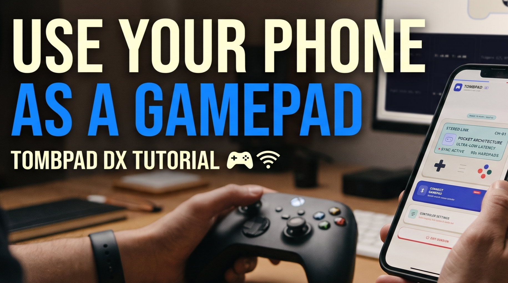
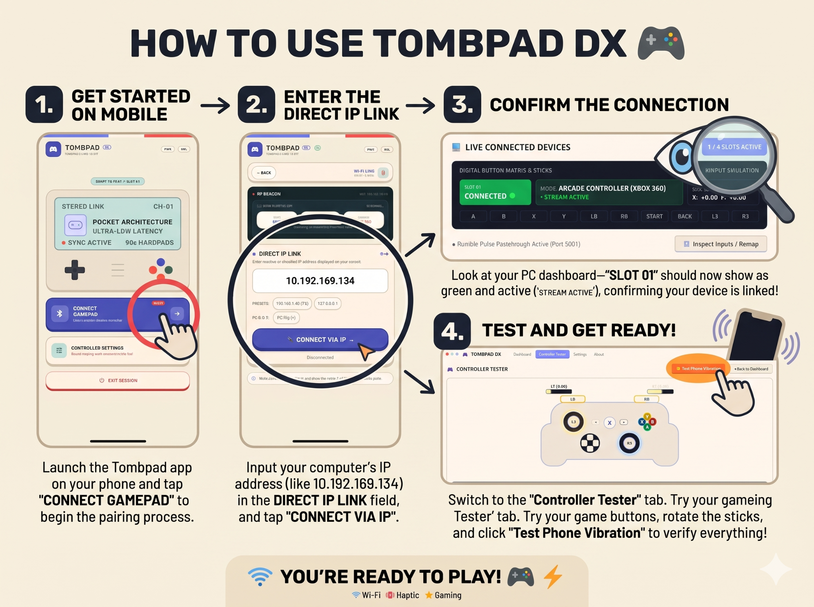
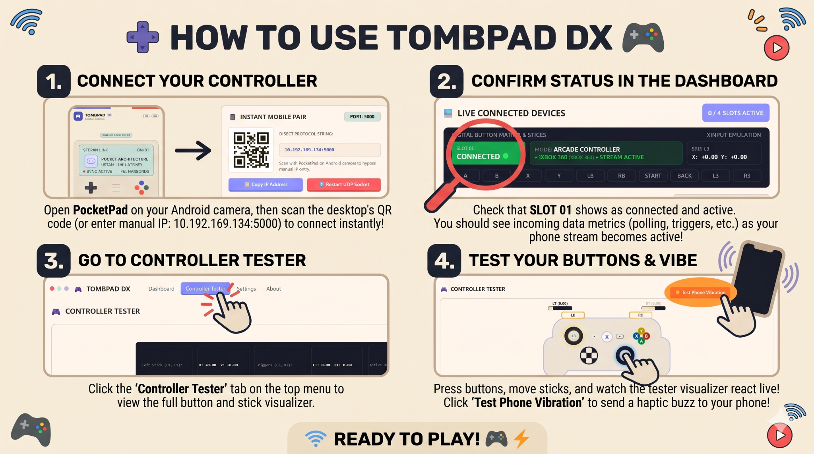

<div align="center">



# GAMEPAD

### Turn your Android phone into a wireless PC game controller.

</div>

---

<div align="center">

## DOWNLOAD & SUPPORT

[](https://github.com/TombStone88/Gamepad/releases/latest/download/TombPad.apk)

[](https://github.com/TombStone88/Gamepad/releases/latest/download/TombPad-PC-Setup.exe)

[All Releases](https://github.com/TombStone88/Gamepad/releases) &nbsp;·&nbsp; [Report an Issue](https://github.com/TombStone88/Gamepad/issues)

</div>

---

## ABOUT THE PROJECT

**Gamepad (TombPad)** lets you use your Android phone as a wireless controller for your Windows PC. The Android app sends touch-based controller input to the PC over your local network, while the PC can send rumble feedback back to your phone.

The setup has two parts: the **Android app** and the **Windows PC app**. Connect both devices to the same Wi-Fi network or hotspot, enter the PC's IP address in the phone app, and connect.

## HOW TO USE

### 01 — Connect from Android

1. Install and open the TombPad APK on your Android phone.
2. Start the PC application on Windows.
3. Make sure your phone and PC are connected to the same Wi-Fi network or hotspot.
4. In the Android app, tap **Connect Gamepad**.
5. Enter the PC's IP address and tap **Connect**.

<div align="center">



**ANDROID — OPEN THE APP AND CONNECT TO YOUR PC**

</div>

### 02 — Confirm and test on Windows

1. Open the PC dashboard and check **Live Connected Devices**.
2. Confirm that **Slot 01** shows **CONNECTED** and the controller stream is active.
3. Open **Controller Tester**.
4. Press buttons and move the sticks on your phone to check that the desktop visualizer responds.
5. Select **Test Phone Vibration** to check rumble feedback.

<div align="center">



**WINDOWS — VERIFY THE CONNECTION AND TEST YOUR CONTROLS**

</div>

> **Network note:** Use the PC's current local IP address. For Windows Mobile Hotspot, `192.168.137.1` is a common address, but verify it on your own PC. Internet access is not required for local controller communication. If connection fails, check Windows Firewall and ensure both devices can communicate over the same local network.

## PROJECT STRUCTURE

The repository's current top-level layout:

```text
Gamepad/
├── app/                  # Android application
├── gradle/               # Gradle wrapper configuration
├── .idea/                # IDE project settings
├── build.gradle.kts      # Root Gradle build configuration
├── gradle.properties     # Gradle properties
├── gradlew               # Gradle wrapper (Unix)
├── gradlew.bat           # Gradle wrapper (Windows)
├── settings.gradle.kts   # Gradle project settings
└── README.md             # Project documentation
```

The `app/` directory contains the Android application module. The PC application is distributed separately through the repository's Releases.

---

<div align="center">

### MADE WITH ❤️ BY [TOMBSTONE88](https://github.com/TombStone88)

If you find this project useful, give the repository a ⭐

[GitHub Repository](https://github.com/TombStone88/Gamepad) · [Releases](https://github.com/TombStone88/Gamepad/releases) · [Issues](https://github.com/TombStone88/Gamepad/issues)

</div>
