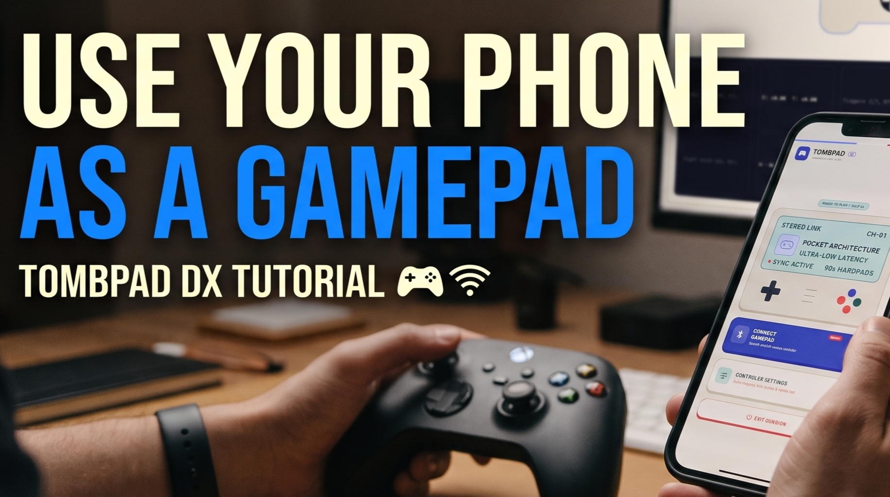
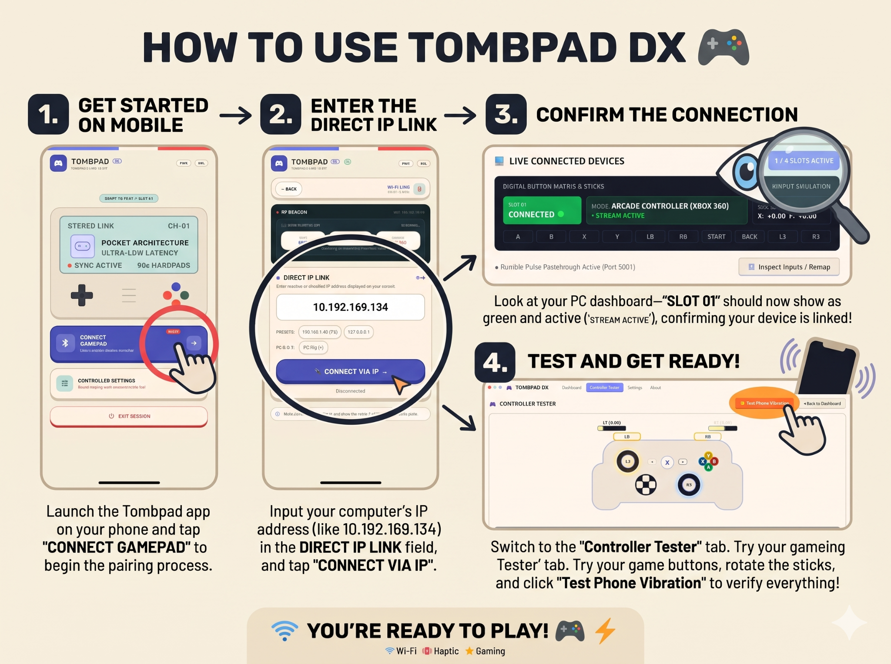
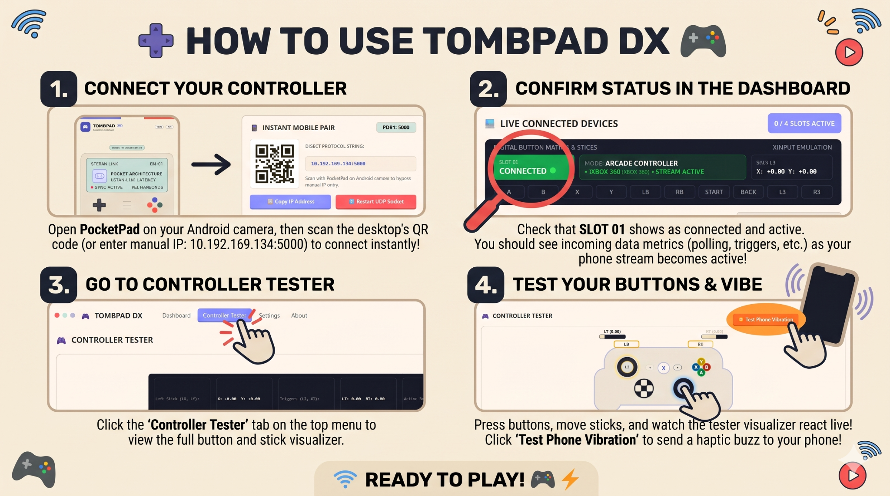

<div align="center">



# GAMEPAD

**Turn your Android phone into a wireless PC game controller.**

[](https://github.com/TombStone88/Gamepad/releases/latest/download/TombPad.apk)
[](https://github.com/TombStone88/Gamepad/releases/latest/download/TombPad-PC-Setup.exe)

[Releases](https://github.com/TombStone88/Gamepad/releases) · [Report an Issue](https://github.com/TombStone88/Gamepad/issues)

</div>

---

## About

**Gamepad (TombPad)** turns your Android phone into a wireless controller for your Windows PC.

It uses a local network to transmit controller inputs and supports rumble feedback from the PC to your phone.

## How to Use

### 1. Android Setup

1. Install and open the TombPad APK.
2. Start the Windows PC application.
3. Connect both devices to the same Wi-Fi network or hotspot.
4. Tap **Connect Gamepad** and enter your PC's IP address.

<div align="center">



*Android — Connect to your PC*

</div>

### 2. Windows Setup

1. Open the PC dashboard.
2. Check that Slot 01 displays **CONNECTED**.
3. Open Controller Tester.
4. Test buttons and analog sticks.
5. Select **Test Phone Vibration** to check rumble feedback.

<div align="center">



*Windows — Verify connection and test controls*

</div>

> **Network:** Both devices must be on the same local network. Internet access is not required. Check Windows Firewall if the connection fails.

## Project Structure

```text
Gamepad/
├── app/                  # Android application
├── gradle/               # Gradle wrapper configuration
├── .idea/                # IDE project settings
├── build.gradle.kts      # Root Gradle configuration
├── gradle.properties     # Gradle properties
├── gradlew               # Gradle wrapper (Unix)
├── gradlew.bat           # Gradle wrapper (Windows)
├── settings.gradle.kts   # Gradle project settings
└── README.md             # Project documentation
```

The Windows PC application is distributed separately through GitHub Releases.

## Copyright & Ownership

**Original Developer:** Nirav Mahida  
**GitHub:** [@TombStone88](https://github.com/TombStone88)

Copyright © 2026 Nirav Mahida. All Rights Reserved.

This project and its original source code, design, documentation, and assets are protected by copyright.

Unauthorized copying, modification, redistribution, or commercial use of the original work is not permitted without prior written permission, except where applicable third-party licenses provide otherwise.

For permission or inquiries, contact the original developer through GitHub.

---

<div align="center">

**Developed by [Nirav Mahida](https://github.com/TombStone88)**

[Repository](https://github.com/TombStone88/Gamepad) · [Releases](https://github.com/TombStone88/Gamepad/releases) · [Issues](https://github.com/TombStone88/Gamepad/issues)

</div>
